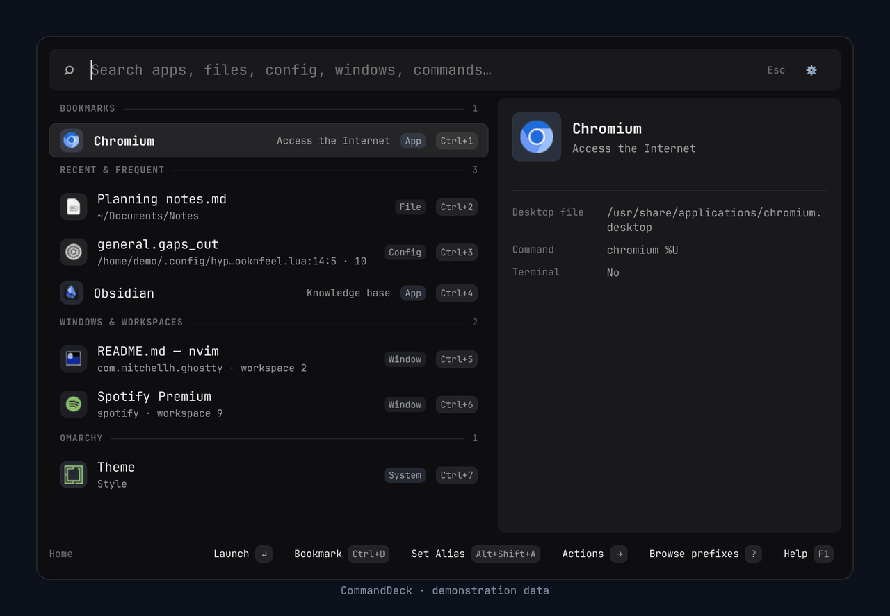
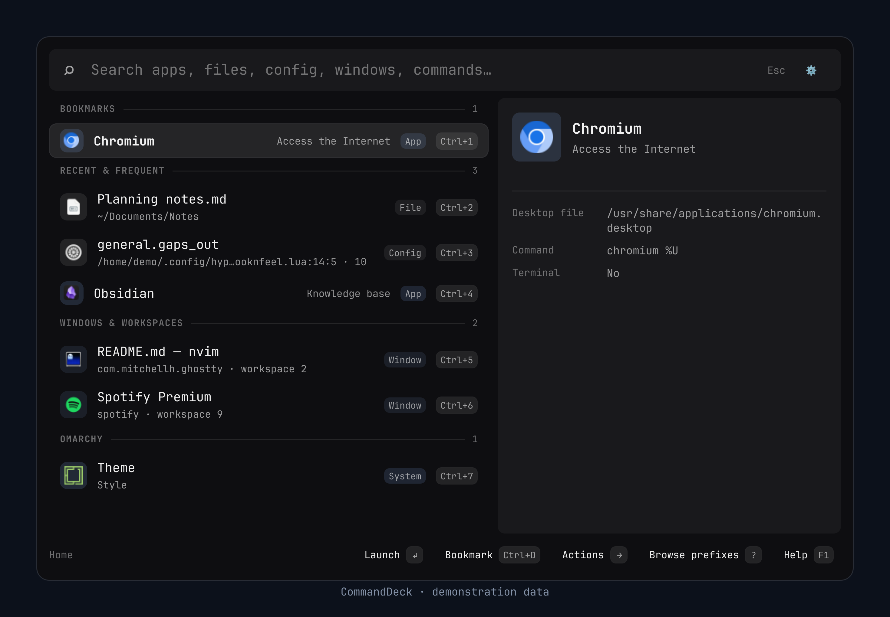
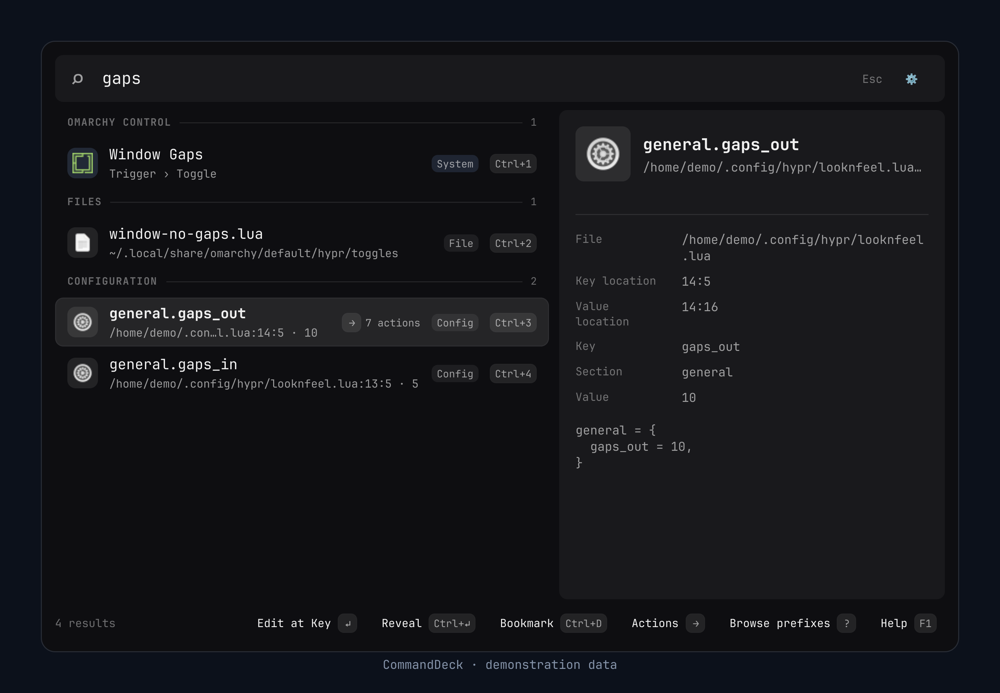
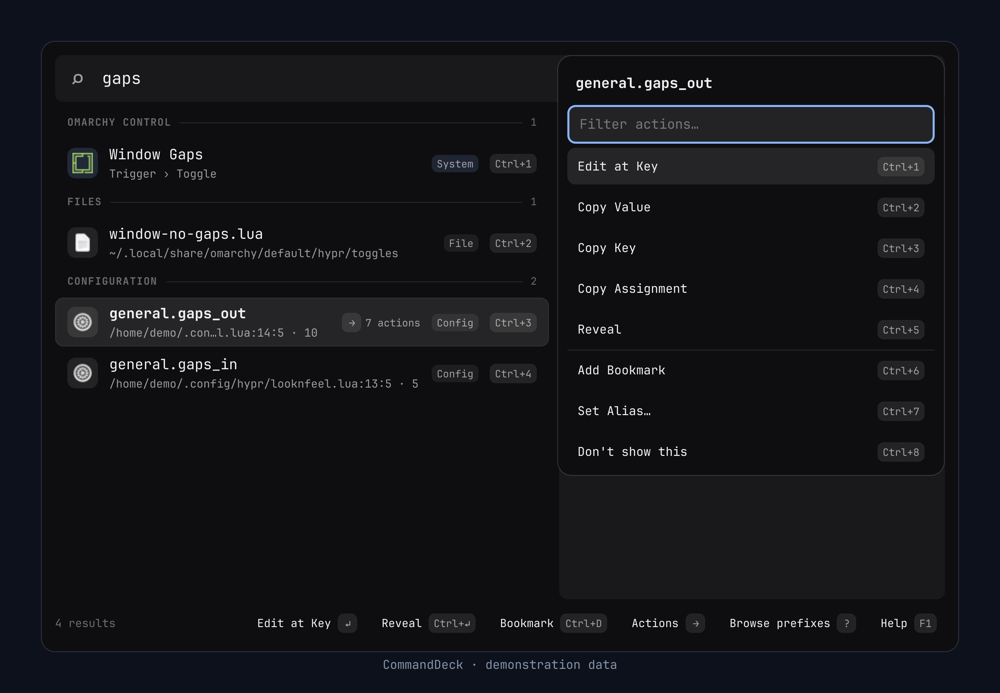
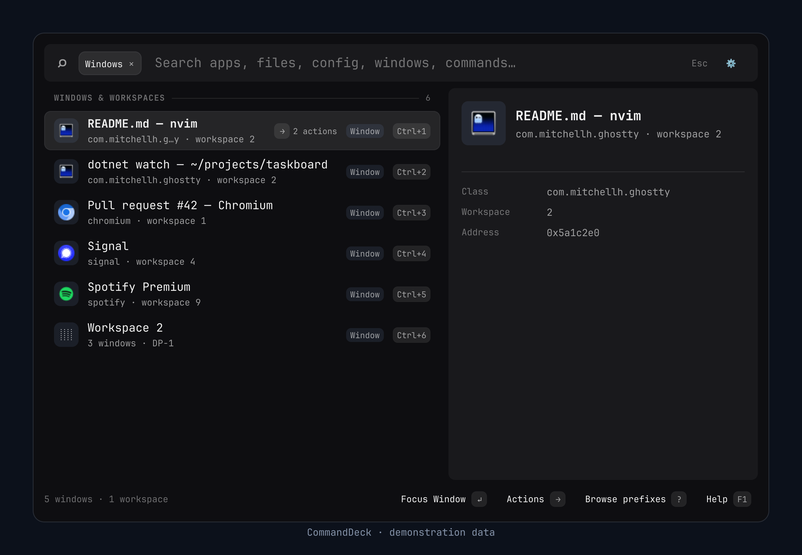
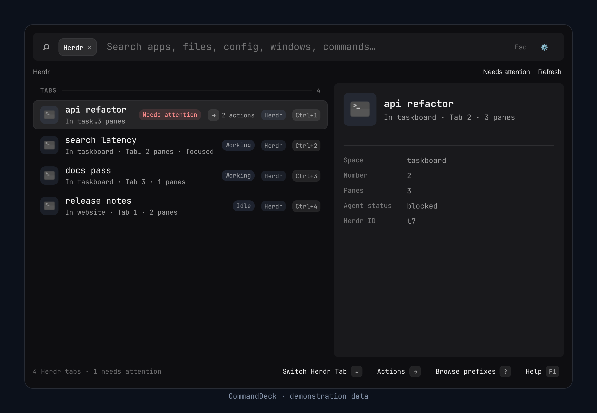
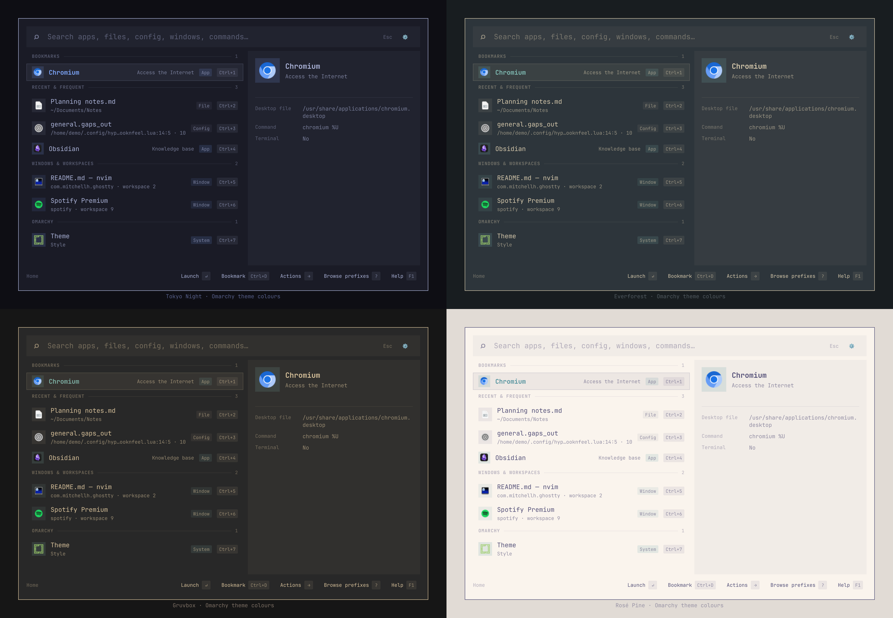
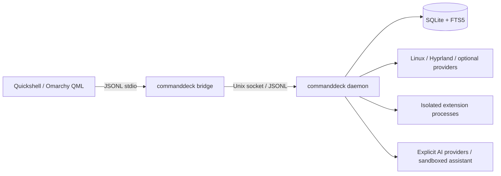

# CommandDeck

[](https://github.com/devmobasa/CommandDeck/actions/workflows/validation.yml)
[](LICENSE)


A keyboard-first command palette for **Omarchy and Hyprland**. Press
**Ctrl+Space** to launch apps, find files and Hyprland config keys, switch
windows, run Omarchy actions, and ask optional AI tools from one search field.

[](docs/gallery.md)

> [!NOTE]
> **Working preview.** Build from source; there are no packages yet. The desktop
> integration needs Omarchy's Quattro shell plugin system or the experimental
> standalone Hyprland host. The extension SDK is experimental.

[Why](#why-commanddeck) · [Gallery](#gallery) · [Install](#install-from-source) ·
[Use it](#use-it) · [Privacy](#privacy-and-ai) · [Documentation](docs/README.md) ·
[Contribute](CONTRIBUTING.md)

## Why CommandDeck

- **One search for the whole desktop.** Applications, files and file contents,
  Hyprland config keys, open windows and workspaces, user services, Omarchy menu
  actions, desktop controls such as volume, Wi-Fi, and window placement,
  projects, snippets, and opt-in clipboard history, grouped by source.
- **Made for Omarchy.** It follows the active Omarchy theme, finds a config key
  at its file and line, runs Omarchy menu actions, opens
  [Omarchy submenus](docs/search-and-ranking.md#omarchy-submenus) in place, and flags
  [Herdr](docs/search-and-ranking.md#herdr-spaces-and-tabs) agent tabs that need attention.
- **Fast.** A Native AOT C# daemon keeps an SQLite FTS5 index. Local validation
  fails if warm search p95 over 100,000 indexed items reaches 20 ms
  ([performance budgets](docs/testing.md#performance)).
- **Keyboard-first, mouse-complete.** **Ctrl+1**–**Ctrl+9** run the first nine
  results, **Ctrl+K** opens a result's actions, and **F1** lists every shortcut
  and filter. Every control also works with the mouse.
- **Private by default.** No telemetry. Query history, clipboard capture, AI, and
  extensions stay off until you enable them.
- **AI that shows its work.** The optional assistant (Codex, Claude Code, Cursor,
  or Grok) runs under daemon-enforced trust levels. Direct providers show the
  exact request before anything is sent.

CommandDeck installs on **Ctrl+Space** and leaves your existing **Super+Space**
launcher in place, so you can try both side by side.

## Gallery

<table>
  <tr>
    <td width="33%" valign="top">
      <a href="docs/gallery.md#home"></a>
      <br><b>Home</b>
    </td>
    <td width="33%" valign="top">
      <a href="docs/gallery.md#find-omarchy-and-hyprland-settings"></a>
      <br><b>Omarchy and Hyprland</b>
    </td>
    <td width="33%" valign="top">
      <a href="docs/gallery.md#act-on-a-result"></a>
      <br><b>Ctrl+K actions</b>
    </td>
  </tr>
  <tr>
    <td width="33%" valign="top">
      <a href="docs/gallery.md#switch-windows"></a>
      <br><b>Windows</b>
    </td>
    <td width="33%" valign="top">
      <a href="docs/gallery.md#watch-herdr-agents"></a>
      <br><b>Herdr agents</b>
    </td>
    <td width="33%" valign="top">
      <a href="docs/gallery.md#turn-notes-into-a-checklist"></a>
      <br><b>Optional AI</b>
    </td>
  </tr>
</table>

CommandDeck takes its colours from the active Omarchy theme, light or dark:

[](docs/gallery.md#follow-your-omarchy-theme)

The screenshots use demonstration data. [Browse the full gallery →](docs/gallery.md)

## Install from source

Install the .NET SDK specified by [global.json](global.json); the
[SDK setup instructions](docs/install.md#install-the-pinned-sdk) include an
exact-pin installer path. Then build and test:

```bash
git clone https://github.com/devmobasa/CommandDeck.git
cd CommandDeck
dotnet restore CommandDeck.slnx --locked-mode
./scripts/build.sh
./scripts/test.sh
```

<details>
<summary>Native build and validation tools on Arch Linux</summary>

```bash
sudo pacman -S --needed base-devel clang zlib sqlite icu shellcheck bubblewrap wl-clipboard jq
```

</details>

Inside a running Omarchy Quattro session, install the user-local app and plugin:

```bash
./scripts/reinstall-all.sh
```

This validates the repository, publishes Native AOT, installs the binary and user
service, reindexes configured roots, installs the plugin, and binds **Ctrl+Space**.
It preserves existing configuration and backs up plugin and binding changes.

> [!WARNING]
> Review your indexing roots before the first reindex. By default, filename
> indexing covers your home directory, including hidden files, with privacy
> exclusions. See [configuration](docs/configuration.md).

To turn it off again:

```bash
omarchy plugin disable local.commanddeck
omarchy restart shell
systemctl --user disable --now commanddeck.service
```

The [installation guide](docs/install.md) covers prerequisites, manual
installation, restoring the backed-up binding and plugin, and the standalone
host. Installation commands change your desktop configuration; ordinary build
and test commands do not install.

## Use it

Press **Ctrl+Space**, then type. **Enter** opens the selected result, **Ctrl+K**
opens its actions, **F1** shows help, and **Escape** clears or closes the current
interaction. Settings controls which sources appear in Search and Home.

| Try | Find |
|---|---|
| `app: firefox` | Applications |
| `file: notes` | Files and folders |
| `cfg: gaps_out` | Indexed configuration keys |
| `win: terminal` | Hyprland windows |
| `oma: theme` | Omarchy controls |
| `100 * 5` / `days until 11 sep` | Calculator and date counts |
| `=100 km to miles` | Unit conversion with optional qalc |
| `ai: explain this` | Optional AI assistant |

<details>
<summary>All filters</summary>

| Try | Find |
|---|---|
| `text: meeting notes` | File contents and paths |
| `ws: 3` | Workspaces |
| `proj: dotfiles` | Projects |
| `snip: review` | Snippets |
| `script: tests` | Script commands |
| `browse: ~/Downloads` | Folder browsing |
| `svc:` | User services and timers |
| `clip:` | Opt-in clipboard history |
| `herdr:` / `htab:` | Herdr spaces and tabs |
| `link: github` | Quicklinks |
| `tz: tokyo` / `time: 3pm london to tokyo` | Time zones |
| `web: wayland layer shell` | Web search |
| `github.com/devmobasa` | Open a typed URL directly, no prefix needed |
| `emoji: rocket` | Emoji |
| `ctl: volume` | Desktop controls: volume, media, Wi-Fi, Bluetooth, color picker, window placement |
| `kill: firefox` | Your own processes, to terminate or force kill after confirmation |
| `hey: invoice` | Optional HEY mail search |
| `codex:` / `claude:` / `cursor:` / `grok:` | A specific assistant backend |

Combine and exclude filters: `file: app: roadmap -workspaces:`. Press **?** in the
launcher to browse every prefix with an example.

</details>

The [launcher guide](docs/launcher-workflows.md) covers projects, snippets,
script commands, clipboard history, folder browsing, desktop controls, process
signals, and piped selection. The
[search reference](docs/search-and-ranking.md) explains filters and ranking.

## Privacy and AI

There is no telemetry. Query history, clipboard capture, AI, and extension
execution need explicit enablement. Usage learning is on by default and can be
disabled or reset. Clipboard and HEY results are private sources: they are excluded
from AI context, assistant tools, suggestions, and query/learning history.

Direct AI providers show the destination and exact request before transmission.
The embedded assistant uses CommandDeck-owned credentials and daemon-enforced
trust levels. Its optional unrestricted level grants broad user-session access.
See [AI integration](docs/ai.md), [security and privacy](docs/security.md), and
the [security policy](SECURITY.md) before enabling those features.

## Develop

Start with [CONTRIBUTING.md](CONTRIBUTING.md) for build/test commands and
[AGENTS.md](AGENTS.md) for repository instructions. The QML frontend talks to the
daemon through a small bridge; search, indexing, storage, and action validation
stay in C#:



The [architecture guide](docs/architecture.md) maps the code and process boundaries.

```text
src/         C# core, Linux infrastructure, app, package helper, extension SDK/tools
qml/         Shared frontend, Omarchy host, experimental standalone host
tests/       Executable backend specs, QML event journeys, gallery scenes, fixtures
scripts/     Build, validation, publish, install, gallery, and extension tools
config/      Example JSONC configuration
schemas/     Generated configuration schema
packaging/   User service and optional privileged helper definitions
samples/     Example extension packages
docs/        App usage, installation, architecture, and contributor references
```

[Documentation index](docs/README.md) · [Configuration](docs/configuration.md)
· [Protocol](docs/generated/current-protocol-contract.md) ·
[Extension authoring](docs/extensions/README.md) · [Report a bug](https://github.com/devmobasa/CommandDeck/issues)

Licensed under the [MIT license](LICENSE).
