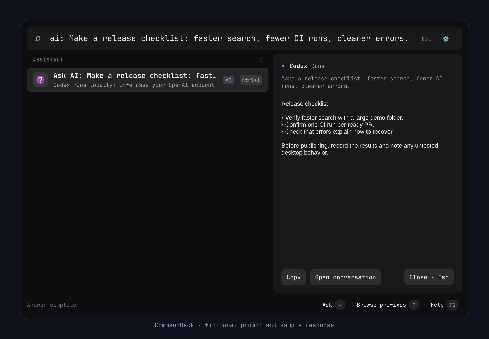
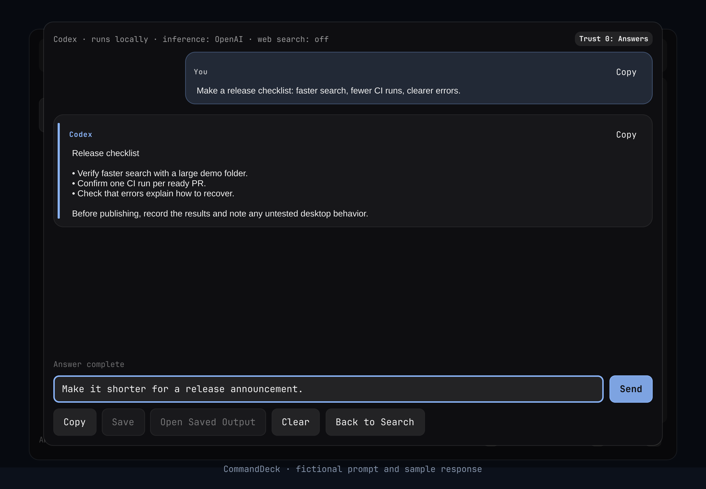
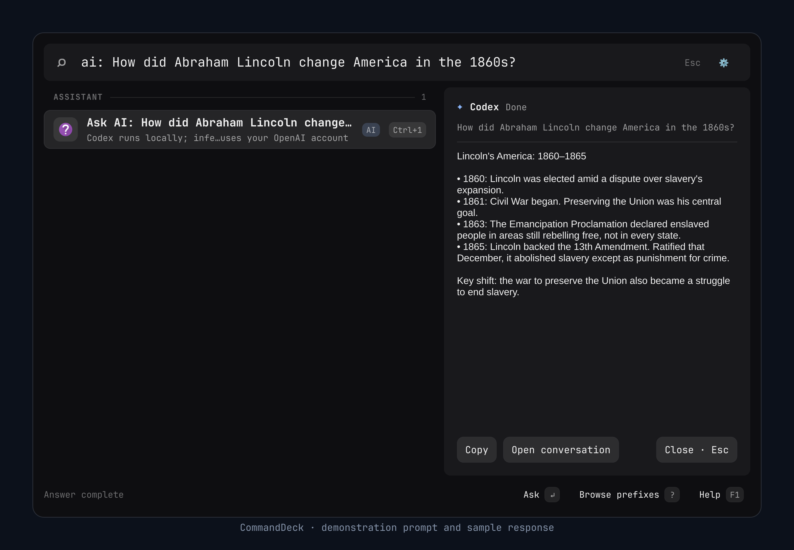

# AI providers and assistant

CommandDeck has two explicit AI paths: direct generation against configured
providers, and an embedded assistant backed by a local agent process. Neither
is required for ordinary launcher search. Both start disabled.

## Direct providers

Configure Ollama or an OpenAI-compatible endpoint in Settings or with
`commanddeck ai providers`. See [configuration](configuration.md#ai)
and `commanddeck --help` for CLI syntax. Settings/CLI manage `ai-providers.json`
beside the JSONC configuration after the first managed change.

Credentials are named environment/systemd references, never literal API keys
in configuration. A systemd user service does not automatically inherit shell
variables. Model discovery occurs on explicit refresh/use, with fixed deadlines.

Before generation, preflight shows the exact endpoint and serialized provider
request, including prompt and attachments. Confirmation binds transmission to
that immutable payload's digest. Direct providers have no tools. Clipboard/HEY
rows cannot be attached. Remote endpoints require explicit opt-in and HTTPS;
plain HTTP is limited to literal loopback IP addresses.

The [request preview in the gallery](gallery.md#review-a-direct-ai-request)
shows a demonstration loopback endpoint, prompt, and serialized JSON before
confirmation. The model identifier is fictional; no request was sent.

Outputs are transient. Copy/save/open are explicit actions; overwrite requires
confirmation. Saving generated output creates an ordinary user-selected file.
Reading provider, template, selection, or settings state on the same connection
stays responsive during generation. `ai.clear` waits for that connection's AI
work to stop, then clears its AI state; file selection and assistant trust
challenges remain until their own clear operation or connection teardown.

## Embedded assistant

With an assistant backend selected in Settings, type `ai: <question>` or use the
AI surface. `codex:` explicitly selects Codex. Enable the assistant and sign in
through its login UI. `commanddeck agent help` describes the CLI. Codex runs via
App Server with a CommandDeck-owned login; the user's own `~/.codex` login is
not read or written. Optional Claude Code, Cursor, and Grok backends have their
own owned homes and narrower, answer-only capability profiles.

The selected backend's CLI and the configured Bubblewrap/systemd tools must be
available. Version constraints and configured executable paths are described in
[the agent configuration](configuration.md#agent).

### Example: turn release notes into a checklist

1. Open **Settings → AI**, turn on **Enable AI features**, and select **Assistant**.
   Turn on **Enable assistant**, select Codex as the backend, and use **Sign in**.
2. Under **Trust and context**, choose **Answers** for this text-only example.
3. Open the launcher, type the prompt below, and press **Enter**.

```text
ai: Make a release checklist: faster search, fewer CI runs, clearer errors.
```

With Codex selected in Settings, `ai:` routes this prompt to the assistant.
Choose **Ask AI** or press **Enter**. The response appears beside search results.
**Copy** copies the answer;
**Open conversation** opens the transcript and composer. Ask
`Make it shorter for a release announcement.` and press **Enter** or **Send**
to continue the conversation.





These screenshots use demonstration text and a sample response. They render the
production UI offscreen without contacting a model service or using an account.
They illustrate the workflow, not a provider or installed-desktop test.

### Example: explore Lincoln's America

With the same Answers trust level and an assistant selected in Settings, ask:

```text
ai: How did Abraham Lincoln change America in the 1860s?
```



Use **Open conversation** to explore the answer further. For example, ask
`Why didn't the Emancipation Proclamation free everyone immediately?` or
`Compare Lincoln's goals at the start of the Civil War with his goals in 1863.`

The sample timeline uses the National Park Service's
[Lincoln chronology](https://www.nps.gov/liho/learn/historyculture/lincolnchronology.htm)
and the National Archives' explanations of the
[Emancipation Proclamation](https://www.archives.gov/milestone-documents/emancipation-proclamation)
and the [13th Amendment](https://www.archives.gov/milestone-documents/13th-amendment).
This is a prepared demonstration response, not a recorded model answer.

### Example: explain science with an analogy

With an assistant selected and Answers trust, ask:

```text
ai: Why does the Moon have phases? Explain it like I'm 12.
```

The [science screenshot](gallery.md#explain-science) shows a sample answer using
a ball and a lamp. Continue with `Give me a simple experiment I can try at home.`
or `Why is a first-quarter Moon only half-lit?`

The prepared answer was checked against NASA's explanations of
[Moon phases](https://science.nasa.gov/moon/moon-phases/) and
[lunar eclipses](https://science.nasa.gov/moon/eclipses/). It is demonstration
text, without a model call.

### Trust and context

| Level | Name | Authority added |
|---|---|---|
| 0 | Answers | Conversation |
| 1 | Launcher | Search and propose existing launcher actions |
| 2 | Approved context | Read files in approved folders; default level |
| 3 | Read entire home | Read under home, excluding protected credential paths |
| 4 | Packages | Package changes through the separately installed helper |
| 5 | Confirmed commands | Exact user-confirmed command execution |
| 6 | Unrestricted | Broad user-session access, requiring a typed phrase and duration |

The daemon enforces the stored trust level, backend capabilities, grants, result
identity, and confirmations. A prompt, read file, or tool result cannot grant
authority or approve its own action. CLI backends do not gain tools merely
because the trust level is higher.

Changing the trust level, an expiring lease, disabling the assistant, resetting
customizations, or changing web search ends turns and backend processes started
under the earlier permissions; work started afterwards keeps running. A turn that
was still starting fails with "Assistant permissions changed while starting; send
again." and its prompt is kept. A settings save checked before such a change is
refused with a conflict instead of being written; review the settings and save
again.

Protected paths include the configured `agent.stateDirectory` and
`agent.runtimeDirectory`, after XDG/home expansion and symlink resolution. This
covers owned backend credentials and temporary credential copies even when those
directories move away from their defaults. Below Unrestricted, reading a protected
path requires a one-time confirmation; approving a parent folder does not bypass it.

File reads and text searches share a 512 KiB context budget per turn. Reads charge
the UTF-8 file text; searches charge the full returned UTF-8 JSON, including match
paths and text. A search that cannot fit the remaining budget returns no matches.
Exhausted turns reject further reads/searches; a new turn starts a fresh budget.

Conversation state is held in daemon memory with a configurable lifetime.
Credentials and acknowledged preferences persist separately. Closing the launcher
can leave an active turn running; Cancel and Clear have explicit behavior in the
assistant surface. Vendor CLIs may retain their own session/cache material inside
their CommandDeck-owned homes, and model services apply their own retention rules.
There is no claim that external providers store nothing.

## Package helper

The helper is optional and installed separately with
`scripts/install-system-helper.sh`. It uses privileged system files and Polkit;
review the script and policy before installing. The daemon never installs the
helper on behalf of a model. An exact package preview and user authorization
remain required. Package changes can outlive cancellation after the package
manager begins; inspect the result rather than assuming rollback.
Commit rechecks enablement and package trust against the current authority.
Permission changes invalidate older previews; restoring trust requires a fresh
preview. Changes made through another runtime invalidate admissions when the
daemon next observes them.

Read [security](security.md), [the threat model](threat-model.md), and
[permissions](permissions.md) before expanding AI authority.
