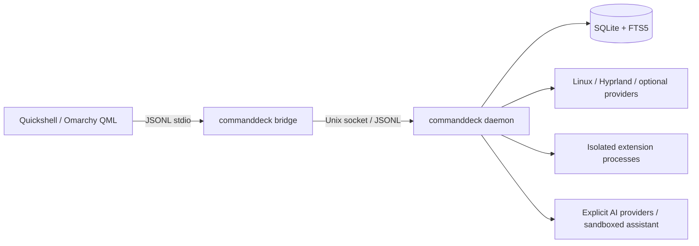

# Architecture and code map

CommandDeck runs as a user daemon. A small bridge translates persistent stdio
JSON Lines from the QML frontend to the daemon's Unix-domain socket. Search,
indexing, persistence, network requests, and action validation stay in C#.

## Project ownership

| Project | Owns |
|---|---|
| `CommandDeck.Core` | Domain records, configuration, query algebra, search coordination/ranking, protocol and permission contracts |
| `CommandDeck.Infrastructure` | SQLite, filesystem indexing/watchers, Linux providers/actions, AI transports, native clipboard, extension isolation/brokers |
| `CommandDeck.App` | Composition, runtime lifecycle, daemon/socket server, bridge, CLI, search/result leases, assistant and extension sessions |
| `CommandDeck.PackageHelper` | Optional separately installed, Polkit-authorized package service |
| `CommandDeck.ExtensionProtocol` | Independent extension wire contracts and validation |
| `CommandDeck.Extensions` | Experimental author SDK; no dependency on daemon assemblies |
| `CommandDeck.Extensions.Testing` | In-memory author tests using the real SDK; no daemon dependency or isolation claim |
| `CommandDeck.ExtensionTools` | Experimental project creation/build/package/development tools |

The backend targets `net11.0`; the public extension packages target `net10.0`.
The app is designed for Native AOT. JSON wire types use explicit serialization
contexts. `Directory.Packages.props` and lock files keep dependency versions
reviewable.

Extension runtime composition constructs one launcher, journal, connection service,
secret resolver and development service. Management, sessions and search receive
their collaborators explicitly. Registry mutation, artifact storage, contributions,
settings resolution and durable data have separate owners. Session launch/cleanup,
child requests, publication and remote confirmation likewise have separate owners;
the session facade retains phase, lifetime and current displayed view.

## Start reading here

- `src/CommandDeck.App/Program.cs` dispatches executable modes; `Program.Help.cs`
  lists CLI commands.
- `src/CommandDeck.App/Runtime/CommandDeckRuntime.Factory.cs` constructs owned
  resources; `RuntimeResources.cs` handles construction rollback and disposal.
- `src/CommandDeck.Core/Search/SearchCoordinator.cs` coordinates providers.
  Query/filter/ranking contracts live beside it.
- `src/CommandDeck.Infrastructure/Storage/SqliteCatalog.*.cs` owns catalog SQL.
  `SqliteLauncherPreferenceStore.*.cs` owns launcher personalization.
- `src/CommandDeck.App/Runtime/AssistantRuntime.*.cs` owns assistant lifecycle
  and state; tool admission and trust are separate daemon services.
- `src/CommandDeck.App/Protocol/` owns socket/server framing and operation handlers.
- `qml/common/CommandDeck.qml` owns the shared overlay; the Omarchy and standalone
  directories provide thin host adapters.
- `tests/CommandDeck.Specs/` groups backend specs by feature; each group's
  `Program.*Registrations.cs` files are its test inventory. `Program.cs` remains
  the shared executable entry point.
  QML event journeys live under `tests/CommandDeck.QmlSpecs/`.

## Storage and authority

Direct `Microsoft.Data.Sqlite` access provides explicit migrations, catalog
metadata, FTS5, usage, preferences, and bounded operational state. Catalog rows
are rebuildable; preferences and private stores have different retention rules.
Do not assume rebuilding the index resets personalization or credentials.

The daemon creates typed actions and binds invocation authority to current
results/sessions. QML renders and requests actions; it does not receive arbitrary
shell strings to execute. Extension features negotiate compatibility; declared
permissions and current grants separately govern effects. AI model text and
tool results cannot approve themselves or raise trust.

The daemon keeps at most 4,096 presented results across clients, including
preview-generated rows. Each store gives a result a fresh invocation reference
and a two-minute monotonic lifetime and moves it to the newest position; reads
do not renew it, and overflow evicts the oldest entry. An expired or evicted
result requires a new search before invocation or customization.

Clipboard capture observes policy changes through a store-owned signal published
with the capture epoch under the store lock. Disabled and paused capture wait for
that signal; retention runs separately on expiry deadlines. The native helper
waits on Wayland, content and eventfd descriptors, with timeouts only for outstanding
work. Cancellation also wakes its nonblocking transport I/O, so partial input and
full output pipes cannot keep a shutdown alive. Failed helper starts and short-lived
sessions retry with exponential delays from one to thirty seconds; a policy change
ends the wait immediately.

Bounded processes use Linux `prlimit` address-space limits when available. The
wrapper installs both limits before executing the target and fails without running
it if enforcement fails. RSS sampling remains the fallback when a finite limit has
no kernel wrapper; unlimited runs need no sampler. Output bounds, deadlines and
process-group cleanup apply in either case.

See [search](search-and-ranking.md), [security](security.md),
[AI](ai.md), and [extension contracts](extensions/README.md)
before changing these boundaries.

Quicklink preferences have a separate migration (23; 22 is left available for
indexed-folder preferences). Quicklink edits update user records, exclusions,
search rows, and any fallback reset in one SQLite transaction. Only quicklink
rows are republished. Full-index publication reads the current preferences in
its publication transaction, so an older scan cannot restore removed links.
The Settings quicklink controller serializes writes and queues actions during
refresh; repeated refreshes share one pending reload.
Dispatch waits for protocol readiness, including the reconnect probe. Quicklink
alias lookup uses a partial expression index, so unrelated catalog rows do not
add search work. Frontend alias rules and validation messages are generated from
the backend validators by `scripts/generate-reference-docs.sh`; backend and QML
tests share URL, host, alias, and error-message cases in
`tests/fixtures/QuicklinkUrls.js`.

Catalog schema versions 20 and 21 link item rows to FTS rowids and persist title
and metadata search inclusion. Applied migrations keep their existing version
numbers. Initialization rejects a newer ledger before changing journal mode or
creating bootstrap tables. Projection repair preserves excluded fields, stale
path paging uses the path index, and maintenance vacuums only when at least a
quarter of the database pages are free. Activation checkpoints do not wait for
active readers; no enlarged activation cache is configured.

Directory and overflow rescans stream into file-backed staging before one atomic
publication. Mixed file/directory batches publish together, including FTS rowid
links and search inclusion. Traversal caches directory policy while revalidating
the path before content reads and after them. Changed ignore files refresh the
rules and recheck previously entered ancestors. Native timestamps remain Unix
milliseconds without a calendar-range conversion. The journal group-commits
pending events; a
durable open-window marker forces reconciliation after a reboot could have lost
unflushed events. Offline metadata comparisons remain size plus modification
time, and a failing root no longer abandons the remaining roots.

ProtocolRoutes owns each operation's handler family and connection admission.
Handlers receive the existing owner-bound request context and fail closed for
unserved operations. ClientSession depends on IClientLifecycle: revoke client
authority, cancel and drain requests, close extension sessions, then release
client state. Daemon-owned assistant turns survive ordinary disconnects. Pacman
preview and helper commit compile one shared database identity definition.

On Linux, each index root owns an inotify instance and one shared reader sleeps
until events or shutdown. Only directories admitted by traversal policy consume
tree watches. Nested roots are watched once; watch-limit failures preserve the
indexed snapshot and report remediation. Resume and reindex rebuild the watcher
set from current root identities, including roots that appeared later.
Overflow recovery replaces affected tree watches before scanning, includes
interrupted overlapping roots in that scan, and preserves other roots' buffered
events. A changed canonical root requires a full catalog scan. Watch admission
rechecks canonical ancestry before adding a kernel watch or enumerating children.
Directory counts are local diagnostics; the wire contract is unchanged.

Native clipboard pipes each own one reusable I/O worker with a bounded queue.
Indefinite pipe waits leave shared workers available for control acknowledgements.
The host cancels and joins transport operations before stream disposal joins these
workers and releases their cancellation descriptors.

Client AI ordering and preflight transport admission share an internal revision
gate. Each owner keeps its own revision and advances it at its existing boundary.
A waiter rechecks after admission, and disposing a lease twice releases it once.
Assistant authority remains owned by AgentAuthority.
