# Search and ranking

CommandDeck combines **Top Matches** with source groups in the user's configured
order. This guide describes the current search contracts.

## Query pipeline

```mermaid
flowchart LR
  RAW[Input and typed clauses] --> PARSE[Parse and route providers]
  PARSE --> MATCH[Bounded catalog and live candidates]
  MATCH --> FILTER[Source preferences and clause filters]
  FILTER --> USAGE[Batch eligible usage IDs]
  USAGE --> SCORE[Final score and stable-ID dedupe]
  SCORE --> COLLAPSE[Collapse configuration matches]
  COLLAPSE --> TOP[Select bounded Top Matches]
  TOP --> GROUP[Allocate source groups and first-page diversity]
```



Most providers receive up to four times the requested limit, bounded by
`search.maximumLimit` (200 by default). Folder browsing retains its own limit and
pagination. A result discarded during candidate retrieval cannot be promoted.
The coordinator keeps the highest-scored result for each stable ID and limits
configuration matches from the same path to two rows.

At admission, the coordinator builds one search plan from the parsed expression,
purpose, selected providers, source preferences, registry revision, context, and
limits. That plan governs provider selection and final source filtering even if
preferences change while providers run. Preference, alias, and hidden-ID reads
are separate store operations; the plan does not claim one atomic database
snapshot across them.

Unfiltered catalog text queries use that frozen source set before candidate
limits. Direct in-process provider callers can omit `EnabledSearchSources`
(`null`) to retain their preference or catalog fallback; an explicit empty set
enables no sources. HEY, Herdr, and extension search require an enabled source
in the supplied set. This request field is not part of the wire protocol.

Fuzzy candidate lookup keeps at most 512 rows. With several selected catalog
sources, each source ranges its own title index with hidden/Home exclusions
before its limit; a bounded merge selects the final 512 candidates. A probe of
the first 512 global titles preserves the streaming title walk when all those
rows are eligible, avoiding a dense-query sorting regression. Unrelated
disabled sources do not add title-scan work. Excluded rows within a selected
source still require eligibility checks; the provider deadline remains the
response bound.

The fuzzy candidate walk uses only rows whose titles are included in search.
Enabled metadata and paths can improve those candidates' scores; they do not
create a separate fuzzy candidate pool. Rows with excluded titles remain
searchable through their other enabled fields in the FTS projection.

Every search outside bare Home runs its providers on independent workers under
one provider deadline. When the deadline fires, the coordinator returns the
results that have completed and reports the rest as timed out once; a provider
that only observes cancellation between rows, such as a blocked live process, keeps
running in the background without delaying the response. The socket search
completion reports the number of selected providers that failed, timed out, or
could not obtain a slot, without provider error text or private query details.

Home's optional Hyprland and Herdr sections each use the configured provider
deadline too. A slow live section cannot hold up the remaining Home sections;
request cancellation stops waiting without releasing a still-running provider's slot.

Each provider has two shared outstanding execution slots. Excess work reports
`saturated` and contributes no rows for that request. Late executions retain slots
until completion; separate provider budgets preserve fast-path capacity. Runtime
shutdown joins executions before disposing their dependencies. Participation lives
in `ProviderEligibilityPolicy`; provider-side I/O gates and final filtering remain.

A row a provider marks as trailing (`ResultPlacements.Trailing`, such as "Search
HEY for …") skips Top Matches and section budgets and follows the ranked rows,
at most two per search. It does not count as a match for the web fallback,
which is inserted ahead of it. HEY-scoped searches (`hey:`, `mail:`, `@hey`)
get a 5 s provider deadline, and their rows keep HEY's order.

Trusted callers select an in-process search purpose: Interactive, Suggestion or
AssistantTool. It is not a wire field. Clipboard history and HEY mail are
private sources (`PrivateSources`). Noninteractive searches never schedule their
providers and remove private output from other providers too. Suggestions
reject private filters, including aliases, exclusions and mixed queries;
historical private queries are omitted from completion results. Invocations
scoped to a private source, including typed exclusions and aliases, do not
record query or learning history, and private rows are never logged, shown on
Home, attached to AI requests, or offered to assistant tools. New clipboard or
HEY saved searches are rejected. Legacy clipboard ones appear in Settings as an
unavailable generic row with Delete only; Home and shortcuts omit them.
Customization exports omit them and report the count in
`omittedClipboardSearches`, preserving the original database rows.

For text queries that can include applications, an application-only catalog
lookup runs beside the full catalog query, so a file-heavy FTS timeout cannot
discard an application match. The lookup is skipped in command mode, under an
explicit `@provider`, and when a `file:`-style filter or `-app:` exclusion would
discard its rows. The coordinator deduplicates both catalog paths by the existing
stable result ID, keeping the exact-alias copy on a tied score, and still applies
source privacy gates and result budgets.

## Query algebra and matching

Multiple positive source filters form a union. Positive text clauses intersect.
Prefix a filter or clause with `-` to exclude it; quoted text remains one
contiguous clause. For example, `file: app: roadmap -workspaces:` combines two
sources while excluding workspaces. `title:"release notes" -path:/private`
constrains displayed fields.

Assistant prompts are literal: `ai: Is -1 negative?` keeps the minus sign,
punctuation, and spacing. Explicit `codex:`, `claude:`, `cursor:`, and `grok:`
prefixes stay in the search field so they retain the requested backend.
Calculator expressions also bypass clause parsing, including negative operands.
For app invocations, arguments after a path, URL, or launch flag stay literal;
`app: firefox https://example.test --private-window` keeps both arguments.
Ordinary search queries continue to support exclusions and field clauses.

Saved queries keep literal input in the optional `expression.literalQuery` field,
including spacing, quotes, negative values, and an explicit assistant backend
prefix. It has the same 4,096-character limit as the request query. Existing
saved expressions with only typed clauses remain supported. Saving or renaming
a query preserves its expression; clipboard and HEY privacy checks still apply.

| Prefix | Meaning |
|---|---|
| `app:` | applications |
| `file:` | files |
| `text:` | file content/path search |
| `cfg:` / `config:` | configuration records |
| `win:` / `window:` | Hyprland windows |
| `workspace:` / `workspaces:` / `ws:` | workspaces |
| `herdr:` | Herdr spaces and tabs; alone, it browses the whole inventory |
| `hspace:` / `hspaces:` / `herdr-space:` | Herdr spaces only |
| `htab:` / `htabs:` / `herdr-tab:` | Herdr tabs only |
| `hattention:` / `herdr-attention:` | Herdr tabs whose agent status is blocked |
| `=` | calculator |
| `>` | command-oriented providers |
| `@provider` | explicit provider ID |

Field IDs are `title`, `metadata`, `path`, `content`, and `config`. Validated
structured clauses cross the socket without being flattened and reparsed.
Catalog queries use parameterized FTS5 prefix phrases and bounded fuzzy
retrieval. Fuzzy matching supports exact, prefix, word-boundary, acronym, typo,
and subsequence matches, including Latin diacritic folding. These weaker matches
can remain useful in groups without qualifying for learned promotion.

## Final score and frequency

The coordinator combines the provider score (weight 0.82), best weighted field
match (0.18), kind prior, and enabled context boosts, then applies the configured
source weight and score bounds. Exact aliases retain their explicit score.
Clients should use ordering and explanations rather than depend on numeric
score ranges.

Catalog scoring already includes frequency/recency. Live windows and workspaces
receive it in the coordinator if their provider has not supplied it. Promotion
does **not** add a second score bonus. The unchanged usage formula is:

```text
frequency = min(0.16, log2(max(0, useCount) + 1) * 0.025)
recency   = 0.12 * exp(-max(0, ageInDays) / 21)
usage     = (frequency + recency) * categoryMultiplier
```

Category multipliers are controlled by `search.ranking.timeAware`. For otherwise
comparable results, ten uses contribute more than two. If final-score saturation
erases this difference, the same-tier tie-break uses the existing weighted usage
signal, then title (`OrdinalIgnoreCase`), then stable ID (`Ordinal`). Stronger
text relevance, explicit intent, and source/context settings can still win.

Empty workspace browsing snapshots the frontend's focused-workspace MRU order
when the launcher opens, then falls back to the backend score and positive
numeric workspace name. The backend score keeps accepted use and the active
workspace ahead, and places occupied workspaces ahead of empty persistent ones.
Typed workspace searches retain relevance ordering instead of applying the MRU
snapshot. Other workspace providers retain the ordinary title tie-break.

## Top Matches and source groups

The `top-match` section is titled **Top Matches** and holds at most three results,
bounded further by the request limit and each source's allowance. Its ordered
tiers are:

1. **Explicit:** exact aliases and calculator results supplied in valid modes.
2. **Exact:** case-insensitive exact trimmed title or path basename.
3. **Learned:** a strong title/basename match with at least two accepted uses and
   last use no more than 21 days ago, inclusive.

Learned eligibility requires at least two positive text elements after matcher
normalization. Every positive unqualified clause must be a whole-title or
word-prefix match in the title or basename. Quoted phrases remain contiguous;
positive `title:` clauses only match the title. Positive `metadata:`, `path:`,
`content:`, and `config:` clauses disable learned promotion. Body-only,
directory-path-only, typo-only, and arbitrary subsequence matches stay grouped.

Only supported time-aware kinds with executable primary actions qualify.
Navigation placeholders, status, suggestions, web fallback, and assistant rows
cannot learn their way into this section. Learning, adaptive ranking, time-aware
ranking, usage privacy permission, and a positive category multiplier must all
permit it. Missing or unavailable usage history gives exact-only eligibility.
The coordinator reads canonical IDs in batches of at most 500; it does not scan
invocation events or issue a query per result.

Promotion consumes the normal total and per-source budgets and never duplicates
a result. Overflow remains eligible for its source group. The default source
cap is 50; default first-page size is nine with a target of two distinct sources.
Promoted sources count toward that target. Learned promotions yield slots to
source diversity; explicit/exact matches take precedence on very small pages.

Group budgets reserve slots for needed sources **before** emitting rows. Groups
remain contiguous and follow configured source order. A source's early group
cannot be extended past a reserved first-page boundary; if later sources have
few candidates, this can yield fewer rows than the request limit. There is no
second copy of an earlier group on later pages.

Bare Home, filter-only queries, and folder browsing retain their prior assembly.
Filtered text such as `app: sig` can promote within its allowed sources.

Set `search.ranking.topMatches.enabled=false` and restart the daemon to restore
the previous exact-only assembly, including its unbounded exact section and old
quota behavior. The switch defaults to `true` and requires no database migration.

## Accepted invocation and privacy

Usage records successful executor acceptance, not application exit or proof of
window visibility. Managed desktop/path/URL launch helpers acknowledge dispatch;
command/script completion semantics remain unchanged. Application argument
variants record their `catalogResultId`, so they learn against the canonical app.

Searching, highlighting, previewing, copying, opening an action menu, rejected
confirmation, and failed dispatch do not train usage. After acceptance, history
completion has its own two-second cancellation scope, independent of launcher
dismissal. Invocation bookkeeping also sets a one-second SQLite command/transaction
lock timeout before acquiring its write transaction; cooperative cancellation
alone does not bound SQLite busy retries. Other catalog operations retain their
configured timeout. A history failure preserves the successful outcome and output, with
an explicit history-not-saved message; it never retries the launch. Exactly once
means once per accepted executor call, not cross-request deduplication.

`learnFromInvocations`, `ranking.adaptive.enabled`, and `privacy.storeUsageHistory`
all gate usage writes. Query history is independently optional and cannot
re-enable usage writes. Invocation events never retain query text; opted-in query
history uses its separate bounded table. The usage count is an aggregate of
accepted invocations, **not** a rolling count within 21 days. Adaptive retention
removes aggregates whose last use is too old.

Turning learning off does not delete history. `commanddeck ranking reset --yes`
clears usage and invocation events; promotion disappears on the next search
without a daemon restart. Query history has its own reset operation.

## Home and keyboard behavior

Home uses existing Saved Searches, Bookmarks, Recent & Frequent,
Windows & Workspaces, Herdr (only when the Herdr source is enabled on Home), and
Omarchy sections according to preferences and available results. Learned
typed-search promotion does not change Home's formula.

Hidden items ("Don't show this" in a result's actions) are excluded on every
catalog path inside the shared candidate-scoping clause, before any `LIMIT`,
so a hidden bookmark or frequent item never consumes a Home or Top Matches
slot. Providers that never touch SQL (extension commands, application launch
variants) are filtered once more in the coordinator by canonical id before
dedup and section budgets. Bookmark position, aliases, and usage survive
underneath and resume on restore.

Settings loads hidden items through `HiddenItemsController` in bounded pages.
The controller owns response correlation, query-aware pagination, dismissal,
and offline recovery. Reopening or reconnecting starts a fresh first page;
responses from closed or superseded requests are ignored. Hide and restore
still use the shared personalization mutation queue.

## Herdr spaces and tabs

When a `herdr` executable is on the daemon PATH, the built-in Herdr source lists
the default session's workspaces (shown as spaces) and tabs through two bounded
`herdr --session default … list` processes per query and matches them locally.
A tab matches through its own label or, at a lower weight, its parent space
label, so searching a space surfaces the space and its tabs. Tabs carry the
parent space in their subtitle. Each positive clause must match independently:
`htab: commanddeck tests` can match the parent space and tab label, while
`htab: title:tests metadata:CommandDeck` restricts each clause to its field.
Quoted phrases stay contiguous within a field, and exclusions apply before the
provider's result limit. Unqualified phrases retain Unicode normalization and
Latin diacritic folding: `htab: "cafe notes"` matches a tab named `café notes`.
Empty Herdr scopes browse in focused-first,
stable inventory order, independent of usage history; text matches still receive
usage boosts. Explicit browsing permits exclusions such as `herdr: -htab:` and
`hspace: -file:`. Accepting a result switches Herdr's session with
a typed focus action. On Hyprland, CommandDeck then marks Herdr's foreground
attached client with a random temporary outer title, resolves the one matching
compositor window, focuses its literal address, and restores Herdr's configured
title. Bounded title cleanup is attempted even if marking times out or is
cancelled. This switches to the Hyprland workspace containing Herdr without guessing
among terminal processes or windows. Focus requires an `ok` dispatcher response;
Lua warnings are treated as failures even when `hyprctl` exits zero.
If no foreground client can be identified,
the action reports that Herdr switched but its window could not be focused. A
missing, stopped, incompatible, slow, or malformed Herdr yields no rows and no
error row. Herdr rows never come from the catalog and are excluded from catalog
source budgets.

Choose **Browse tabs** in a space's action menu to search within that exact
space ID. The browse bar offers **Needs attention**, **Refresh**, and **Back**.
While a Herdr view is open, it refreshes every two seconds after the previous
search settles. Updates preserve the selected stable ID, query, and keyboard
focus. Polling pauses during typing debounce, pending actions, dialogs,
extensions, reconnect reconciliation, and whenever the launcher is closed or
offline. Ordinary searches and Home do not poll. Manual Refresh remains available.
Escape clears the browse text first, then returns to the previous search and
selected space. Source filters still union and clauses intersect: `herdr:
-hattention:` excludes blocked tabs, while `herdr: hattention:` includes all
Herdr rows. Status badges show working, idle, or needs attention; missing or
unknown status does not imply an idle agent. Space details preview up to eight
tabs with pane counts and reported status.

Spaces offer **New tab in this space**; tabs offer **Rename tab**. The name
dialog accepts up to 512 characters without control characters. The daemon
binds names to cached result identities and passes them as literal CLI arguments.
Creation uses `--no-focus`; edits refresh the launcher and do not train focus
history. A missing or invalid acknowledgement is an unconfirmed change, never
an automatic retry. Refresh before retrying to avoid creating a duplicate tab.

Projects (`proj:`) and folders in `browse:` offer **Open in Herdr**. On invocation,
the daemon reads bounded workspace and pane inventories from the default session.
It reuses a space whose reported pane `cwd` or worktree `checkout_path` exactly
matches the normalized absolute folder path, preferring the focused space when
several match. Names, transient foreground-process directories, and parent-path
prefixes are not project identity. Otherwise it creates one space with that folder
as `--cwd`, verifies the acknowledgement, then focuses the space and its terminal.
The action requires an existing folder and an available Herdr session. Incomplete
inventory prevents creation: every workspace must have exactly its reported
number of distinct panes. Project opens and ordinary workspace/tab focus actions
share one gate: overlapping actions are rejected until focus, terminal activation,
and title cleanup finish. Unconfirmed creation or focus is
never retried automatically. A terminal-raising failure is reported even when the
space opened.
The action uses the cached result path, accepts no client-supplied path input,
and launches no preset commands or agents. See Herdr's
[CLI contract](https://github.com/herdrdev/herdr/blob/v0.9.0/docs/next/website/src/content/docs/cli-reference.mdx).

Headers have no invocation ordinal and are skipped by result navigation.
Up/Down, Ctrl+Home/End, and numbered shortcuts follow displayed results. Same-query
refreshes keep the visible list until `done`, then preserve the selected stable
ID even when its section changes. Navigation while waiting remains effective; a new
query or disappearing selection chooses the first result. Action menus retain
their opening result identity, and stale query responses cannot replace results.
Space in the search input continues to type text.
Escape closes the launcher. In Settings > Customization, Escape can clear a typed
search or filter first, and a search you close can be kept for 30 seconds to
10 minutes so reopening shows it with its selection. A search an action ran
from, a private-source search, and an explicit open query are never restored.
Shift+Escape returns to an empty search on Home from any filter or folder.

Moving the pointer over a result selects it without taking focus from search.
A row that appears or scrolls under a resting pointer, including when the
launcher opens, does not take the selection from the keyboard.

With query history on (`privacy.storeQueryHistory`), Up from the first row of an
empty search recalls the most recent query and searches it; Up again on the
unchanged query recalls the next older one. Each query appears once. History is
read when Up is first pressed after opening and forgotten when the launcher
closes; with history off, Up there does nothing.

## Explanations and validation

**Why this result?** shows numeric contributions, matched fields, indexing
policies, and section placement. Optional `ranking.placement` describes the tier,
reason, promotion decision, and (for eligible learned rows) canonical usage ID
and last-use age. Placement is separate from contributions, which still sum to
`finalScore`. See the [protocol reference](generated/current-protocol-contract.md).

The [versioned corpus](../tests/fixtures/ranking-corpus-v1.json) covers cold and
learned ordering. Its `relevanceCases` section runs additional Linux queries
through `SearchCoordinator` and temporary SQLite FTS. Those cases compare stable
IDs inside the default first-page window of nine rows: acceptable IDs, required
and forbidden visible IDs, an empty result, a result-count ceiling, and typing
prefixes. A missing acceptable ID scores reciprocal rank zero. Required,
forbidden, empty, ceiling, and section checks fail the case. Top-one accuracy,
mean reciprocal rank, and visible recall for this section are gated at the
measured 1.0 baseline, separately from the strict pipeline gate, which also
stays at 1.0. Typing checks
require the expected ID to stay visible; they do not require the same order at
every keystroke. One sequence changes intent on purpose so stability is not
demanded after the query means something else.

`--top-matches-benchmark` on the executable specs reports ranks,
top-three membership, provider candidate counts, and paired legacy/current
p50/p95 timings with warm and fresh SQLite connections. Fresh connections do not
mean a cold operating-system filesystem cache. The standard quality gate also
checks a 100,000-item fixture. Installed Wayland behavior is a separate acceptance
check; build and offscreen QML results do not establish it.

Catalog text searches interrupt the active SQLite connection on cancellation and
release that registration before returning the connection to its pool. Ranked FTS
candidates and their displayed item rows use one read snapshot. Open With is
resolved only for visible indexed files, with a 150 ms wait and two outstanding
detections; runtime shutdown joins unfinished detection.
