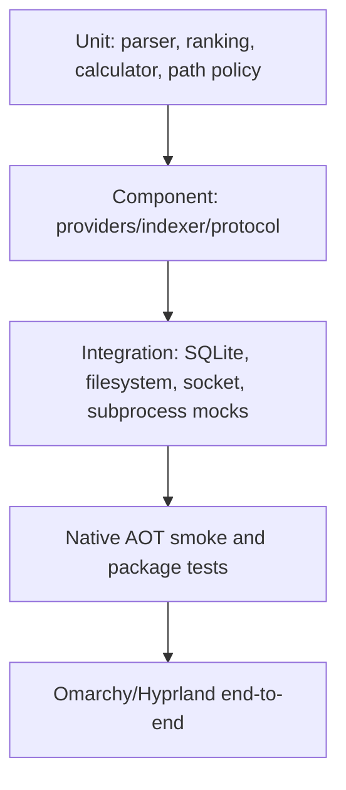

# Testing strategy

Testing must protect:

- search semantics and ranking;
- privacy exclusions;
- action safety;
- current protocol correctness and drift before the first public release;
- SQLite/FTS behavior;
- AOT/trimming compatibility;
- Omarchy focused-monitor/focus behavior;
- provider failure isolation;
- x64/ARM64 packaging.

A passing JIT unit suite is not sufficient for a Native AOT desktop service.



## Choosing verification

| Change | Check |
|---|---|
| Documentation or agent guidance | Verify claims against source, check referenced commands and local links, and run `git diff --check`. |
| Backend behavior | `scripts/test.sh` (Release executable specs). |
| C# formatting and imports | `dotnet format CommandDeck.slnx --verify-no-changes --no-restore`, in addition to behavior checks. |
| QML behavior | `scripts/test-qml-components.sh` (Quickshell component assertions and Qt 6 real-event tests); lint changed QML with Qt 6 `qmllint`. |
| Current protocol or source/filter registry | `scripts/generate-protocol-contract.sh`, then backend drift specs and affected QML checks. |
| Broad repository validation | `scripts/validate-repository.sh`. |
| Native AOT or delivery | `scripts/publish-aot.sh linux-x64` and the applicable installed acceptance checks. |

Choose checks that can detect defects in the changed behavior. After they pass,
repeat or broaden them only for a new change, failure, or unresolved concern.
For UI changes, the keyboard-navigation requirements in `AGENTS.md` still
apply. For security boundaries, retain the relevant rejection and containment
fixtures. Report the commands actually run and their results; prior reports
remain evidence only for their recorded snapshot.

`dotnet scripts/validate.cs PROFILE` composes the existing gates and writes
`build/validation-profile.json` with passed, failed, and skipped outcomes. Profiles:

| Profile | Required scope |
|---|---|
| `partial` (default) | Existing repository gate; unavailable desktop tools are explicit skips. |
| `qml` | Focused QML lint, Quickshell components, and Qt 6 real-event tests. Quickshell, both Qt tools, and Omarchy's `qs.Commons` module are mandatory; the Omarchy CLI is unnecessary. |
| `desktop` | Repository gate with no backend skips, plus mandatory Quickshell, Omarchy validation, Qt 6 lint and event runner. Existing test-count floors still apply. |
| `extensions` | Repository gate, author test kit, independent SDK consumer, and host/child sandbox journey; Bubblewrap is mandatory. |
| `aot` | Repository gate followed serially by linux-x64 AOT publish/smoke on a native x64 Linux host. |
| `linux` | Repository gate once, followed by all extension and Native AOT checks; Bubblewrap and a native x64 Linux host are mandatory. Desktop tools remain optional. |
| `all` | All of the above; excludes installed desktop and privileged-helper acceptance. |

Use `--preflight-only` to inspect tool requirements without executing suites; its
report is tool availability evidence only. `dotnet scripts/test-validation.cs`
checks missing-tool failure/skip behavior and Linux check composition in child
processes. Extension wire/SDK changes require `extensions`; host/native-lifetime
changes also require `aot`.
QML changes require `qml`; plugin integration additionally requires `desktop`.
Set `OMARCHY_PATH` to an Omarchy checkout containing `shell/Commons/qmldir` when
the module is not installed at `/usr/share/omarchy`. Helper changes require backend contracts and
separately authorized installed Polkit/disposable-machine acceptance. The tracked
GitHub Actions workflow runs the combined `linux` profile and a separate `qml` job
on pushes to `main`, ready PRs, and manual dispatch. Draft PR jobs are skipped;
marking a PR ready starts validation. Feature-branch pushes do not duplicate PR
runs. Build, backend specs, formatting, and quality checks execute once per run.
The QML job provisions Quickshell and Qt in Arch, pins Omarchy's shell module,
and starts headless Sway for the production layer-shell surface. It also exercises
buttons under Qt's generic platform theme. The Linux job provisions a user
systemd manager, a session bus, and Bubblewrap for real child isolation.
Each job uploads its applicable validation evidence. Desktop acceptance
requires its own environment. Local scripts
and the workflow do not establish remote branch protection or required checks.

## Executable specifications

`tests/CommandDeck.Specs` is a console test harness without a test-framework
package. Specs are registered explicitly in `Program.*Registrations.cs` and
run through `dotnet run`, not test-runner discovery. The suite covers search
and ranking, real SQLite contention, indexing/watchers, process/socket/CLI
behavior, actions, provider contracts, privacy, and the embedded assistant.
Use the registrations and current output for the test inventory and counts.
Changing test frameworks is a separate decision, not a prerequisite for adding
coverage.

Source files are grouped by feature under the project directory:

| Folder | Scope |
|---|---|
| `Core/`, `Harness/` | Core contracts, architecture/generated-reference checks, test selection/reporting |
| `Search/`, `Catalog/`, `Indexing/` | Queries, ranking/corpora, personalization, SQLite, filesystem/index policies |
| `Actions/`, `Workflows/` | Typed actions, desktop launches, projects, snippets, picker and previews |
| `Ai/`, `Agents/` | Direct AI, assistant authority/lifecycle, Codex and CLI backends |
| `Clipboard/` | Capture, native transport, storage, views, and actions in separate subfolders |
| `Extensions/`, `Packages/` | Extension contracts and package catalog/helper boundaries |
| `Protocol/`, `Runtime/` | CLI/socket operations, request and runtime lifetimes |
| `Providers/`, `Performance/` | Built-in providers, HEY/Herdr, and opt-in benchmarks |

`Program.cs` stays at the root. Partial-class filenames and namespaces are
preserved; moving a file does not change its spec names or category. Place new
tests and their feature-specific fixtures beside related tests. The SDK includes
subfolder source files automatically, and the file-size guard scans recursively.

Use `dotnet run --project tests/CommandDeck.Specs -c Release -- --list` to list
names in deterministic order. `--filter TEXT` selects case-insensitive name
substrings; `--category Core` selects the registration group. They can be combined.
`--results PATH` writes JSON with each selected name, category, duration, outcome,
full failure diagnostic, and prerequisite skip reason. `executed` counts passed
and failed tests; `skipped` is separate. `--require-no-skips` (or
`COMMANDDECK_REQUIRE_NO_SKIPS=1`) fails when a selected fixture cannot run.
Unmatched selections fail. All fixtures remain serial,
including environment and log-sink fixtures; list mode executes no fixtures.
The harness sets `COMMANDDECK_HEY=off` before any fixture, so runtimes under
test never use the developer's own HEY CLI; HEY specs inject their own runner.

Fixtures must contain synthetic data only. Never commit a real home directory,
browser database, prompt, token, or private config. Security boundaries are
covered by rejection and containment specs; see
[the threat model](threat-model.md#verification-boundaries) for what they do and
do not establish.

### Clipboard idle and teardown checks

The native clipboard journey uses a synthetic Wayland server and samples the
helper's voluntary context switches while idle, then exercises receive deadlines,
backpressure, cancellation, serving and reuse. Its Shutdown cases leave input
pipes open, including an incomplete frame and a full output pipe; successful exit
must come from the control request. The same journey runs against the published
binary through `--clipboard-native-aot` during AOT validation.

Separate child fixtures measure idle capture while disabled, paused and active,
and bounded process execution with finite kernel limits and unlimited memory.
The limits fixture reads the child's real soft and hard limits. A Bubblewrap
fixture hides `prlimit` only inside its child namespace and verifies that the RSS
fallback stops an allocating child; an unavailable sandbox is reported as a skip. Retention uses the
store's existing `TimeProvider` to advance expiry and timer deadlines, checking the
database directly so read-time pruning cannot conceal a missing scheduled pass.
These fixtures do not access the desktop clipboard or establish installed compositor
behavior.

### Protocol contract

`tests/fixtures/protocol/current-contract.json` and
`docs/generated/current-protocol-contract.md` are generated from the Core
operation/message constants plus source/filter registries. Run
`scripts/generate-protocol-contract.sh` after an intentional current-contract
change; the executable drift spec rejects stale artifacts and unknown QML
operation literals.

Before the first public release, these fixtures describe only the current
tree: Core, daemon, bridge, CLI, and QML move together, and no old/new client
matrix is required. The first public release establishes the baseline from
which explicit compatibility fixtures and upgrade tests are added.

### Extensions

Extension session specs run the real SDK through an in-process launcher, without
Bubblewrap or systemd; the `extensions` validation profile separately checks
confinement.

The author test package references only the SDK and protocol. Its conformance
specs exercise the real SDK; `scripts/test-extension-testing.cs` independently
packs the local preview feed and runs LocalDraft.Tests under .NET 10 in managed
and Native AOT modes. Renderer golden fixtures retain normalized pre-refactor
payloads, including paging, forms, images, deep stacks and Back. The address-policy
spec compares the prior implementation at CIDR boundaries and across seeded IPv4,
IPv6 and mapped-address samples; changing the policy requires an explicit decision.

### Assistant

The embedded assistant has four test layers.

1. **Contract specs.** Trust levels, preference bounds, package-name grammar,
   argv validation, the generated `config.toml`, the Bubblewrap and
   transient-unit argv, the credential store, the context broker's protected
   paths and grant identity checks, the command tool's plan and digest, and
   the trust service's challenges and leases run without any process.
2. **Fake App Server specs.** An in-process JSON-RPC peer scripts model lists,
   login routes, thread and turn lifecycles, tool calls, user-input requests,
   failures, interrupts, and declined server requests. The Codex adapter is
   driven end to end, including credential copy-back and runtime-home wipe,
   with a fake `codex` binary that only reports its version.
3. **Socket specs.** A scripted `IAgentBackend` replaces Codex through the
   runtime's test seam. The specs prove that turns stream under one request,
   continue when a client disconnects, park questions for a second client,
   expose Home rows, reuse the safe output path, reject forged trust changes,
   and reset authority on disable.
4. **QML and CLI.** Component assertions and real-event tests cover the
   controller, the conversation surface, the settings section (specs select
   the page they exercise with `showPage`; a tab fence keeps focus inside the
   dialog, which the twenty-Tab spec now proves on a short page), and the
   Escape ordering. A process-level spec covers `commanddeck agent` and the
   doctor checks.

Two things are not automated and stay owner tasks: the Codex tool inventory
probe against a real login, and the privileged helper's Polkit prompt plus the
disposable Arch install proof, which need the helper installed with `sudo`.

### QML

QML event journeys live in `tests/CommandDeck.QmlSpecs/tst_*_events.qml`, with
shared controls in `EventPathFixture.qml` and shared setup in
`EventPathTestCase.qml`. Other focused `tst_*.qml` suites remain alongside them.
The Quickshell component harness in `shell.qml` delegates assertions and fixtures
to the `Assertions/` components. `scripts/test-qml-components.sh` stages these
components together and reports assertion and named event-test counts separately.
The production-host journey waits for request, row, and focus readiness with
bounded deadlines. Its delayed-search and delayed-result fixtures exercise
asynchronous replacement without changing production timings.

Saved-search shortcut journeys use one monitor and wait for the Qt window to
be active as well as the expected editor to have focus, including after reopen.
The CI compositor holds a virtual keyboard open without typing so its headless
seat can activate the window; QtTest supplies the key events.

The headless component gate has two layers: Quickshell instantiates the real
`CommandDeck` surfaces with protocol I/O disabled, and Qt Quick Test delivers
keyboard and pointer events to the same search, action, alias, source-toggle,
and confirmation components used by the panel. Installed desktop focus and
screenshots belong to desktop acceptance.

## Native AOT

`scripts/publish-aot.sh [linux-x64|linux-arm64]` publishes the app to
`artifacts/publish/RID`, fails on IL trimming or AOT warnings, and records `file`
output, plus `ldd` output for linux-x64. On a matching host it then runs a smoke
sequence with isolated XDG directories, including `version` (which must report
Native AOT), `config init`, `reindex`, `doctor`, Home and calculator searches,
preference commands, and AI provider queries. For a different RID it publishes
without the runtime smoke. The `aot` validation profile runs it for linux-x64 on
a native x64 host.

The profile also runs `--native-index-aot` in the spec harness against the
published daemon. An isolated indexed root receives create, edit, rename and
delete events, while an excluded subtree stays absent from search. The public
socket reports watcher readiness, and SIGTERM must finish graceful shutdown.
This qualifies native watcher execution without installing the app.

## Performance

Personalization/search budgets use the opt-in disposable fixture:

```bash
scripts/benchmark-phase3.sh
```

It creates 100,000 catalog rows and 10,000 usage rows and reports warm p95
bootstrap, exact-alias, and home-query latency. Source-preference overhead is a
paired p95 delta between otherwise identical coordinators over the same
preloaded candidates, with alternating execution order and no zero clipping.
It remains separate from the correctness suite. Additional performance budgets
need representative baselines before becoming gates.

The repository gate also runs a machine-readable five-dimension quality
fixture:

```bash
scripts/quality-gate.sh [build/quality-metrics.json]
```

It indexes 100,000 rows, runs the versioned catalog/provider ranking corpus,
and fails when top-one accuracy or MRR falls below 1.0, warm search p95 reaches
20 ms, allocation reaches 2,000,000 bytes per search, runtime process startup
p95 reaches 2,000 ms, or SQLite growth reaches 2,048 bytes per item. The same
run checks fuzzy-search p95 against 20 ms in a separate skewed fixture: 100,000
disabled-source rows, 512 hidden selected-source rows, and 64 visible rows across
two sources. The JSON includes `sparseFuzzyFixtureItems`,
`sparseFuzzyP95Milliseconds`, and `sparseFuzzyP95BudgetMilliseconds`. A backend
regression also measures actual SQLite instruction work at 5,000 and 100,000
disabled rows, avoiding machine-dependent timing as its correctness gate.
It also records the Linux `relevanceCases` pass count, top-one accuracy, mean
reciprocal rank, and visible recall. Those aggregates are gated at their
measured 1.0 baseline and do not replace the strict pipeline gate. Case
failures in that section still fail the spec. The JSON
artifact contains every observed value and its budget so CI can retain and
trend it without scraping console prose. These are regression ceilings, not
claims that all devices will match the development machine.

The shared GitHub runner records search and startup latency without enforcing
their machine-specific ceilings. Its quality gate still enforces ranking,
allocation, and database size. The JSON report records `latencyEnforced`,
`latencyPassed`, and `rankingAndFootprintPassed` explicitly. Local validation
continues to enforce every ceiling.

## Installed desktop acceptance

Offscreen suites do not establish installed Wayland behavior. Check an installed
build manually across:

- one monitor and two monitors;
- focus moved left or right before opening, and focus changes while open;
- a full-screen window and a scaled or rotated monitor;
- the native launcher retained and replaced;
- a missing bridge, a missing daemon, and daemon or shell restarts;
- theme changes;
- the keyboard-only action panel;
- window commands on a scaled, rotated, or second monitor;
- long and Unicode results;
- an AI response.

### Hotkey-to-visible latency

`scripts/measure-toggle-latency.cs` is a manual acceptance check for an
installed build on a live Omarchy session. CI and the validation profiles do
not run it.

```bash
dotnet scripts/measure-toggle-latency.cs --self-test
dotnet scripts/measure-toggle-latency.cs --live --samples 20
dotnet scripts/measure-toggle-latency.cs --live --samples 20 --path shell
```

Each sample sends `hl.dsp.global("commanddeck:toggle")` through Hyprland's
request socket. This is the dispatcher that the hotkey binding calls. The script
then measures the time until the event socket reports `openlayer>>commanddeck`.
It toggles again and measures the time until `closelayer>>commanddeck`. It
prints each sample, then the nearest-rank p50 and p95, the minimum, and the
maximum. The script never types keys, so the result does not include the time
for a key press to reach Hyprland's binding. `--path shell` starts
`omarchy-shell shell toggle` for each toggle. This is the process-per-press path
of the earlier binding, for comparison.

The script refuses to run without `--live` or without a Hyprland session. It
also refuses while `commanddeck:toggle` is not registered or CommandDeck is
open. Close other overlays first: the launcher opens and closes on the focused
monitor during the run. Record the machine, the monitor setup, and the build with
the result, because latency depends on the machine.

`--self-test` needs no session. Run it from the repository root. It checks event
matching, layer and shortcut parsing, options, session refusal, and percentiles
on recorded lines. It also checks that `CommandDeckWindow.qml` declares the
`commanddeck` layer namespace that the script measures. The picker and the HUD
use `commanddeck-picker` and `commanddeck-hud`.

## C# formatting

Run `dotnet format CommandDeck.slnx --no-restore` to repair solution formatting
and unused imports, then run the verification command above. Restore the solution
first. Use `--include PATH...` to limit a repair to selected files, and inspect
the resulting diff.

The repository uses LF for all text, including C#, C# scripts, and Razor.
`.editorconfig` and `.gitattributes` agree on this convention, so Linux editing
tools and Git checkouts do not conflict with the C# formatter. Binary files are
not converted. Existing working files may retain old CRLF endings until formatted
or rewritten; a clean Git diff alone does not prove their on-disk line endings.
File-based scripts outside the solution need their own formatting check.

Ordinary builds do not run the full formatting/import check. Passing backend
specs alone does not establish formatting compliance. The existing full repository
validation also runs the solution formatter in verification mode.

## Validation evidence

The repository gate generates `build/validation-report.md` from the same
uninterrupted run. The report is intentionally ignored rather than committed: it
names the exact tested commit, dirty/clean state, source snapshot digest, tool
versions, and executed suite counts. Repositories without commits report
`unborn (no commit)` and retain the actual source snapshot digest; validation
does not create Git history. Tracked minimum counts in
`scripts/validation-baseline.env` reject zero discovery and accidental test
removal.
The backend floor counts passed and explicitly skipped registrations together;
reports show each separately. Desktop/all profiles still reject every backend
skip. Native prerequisites unavailable on a partial or AOT host cannot be
reported as passing tests.
